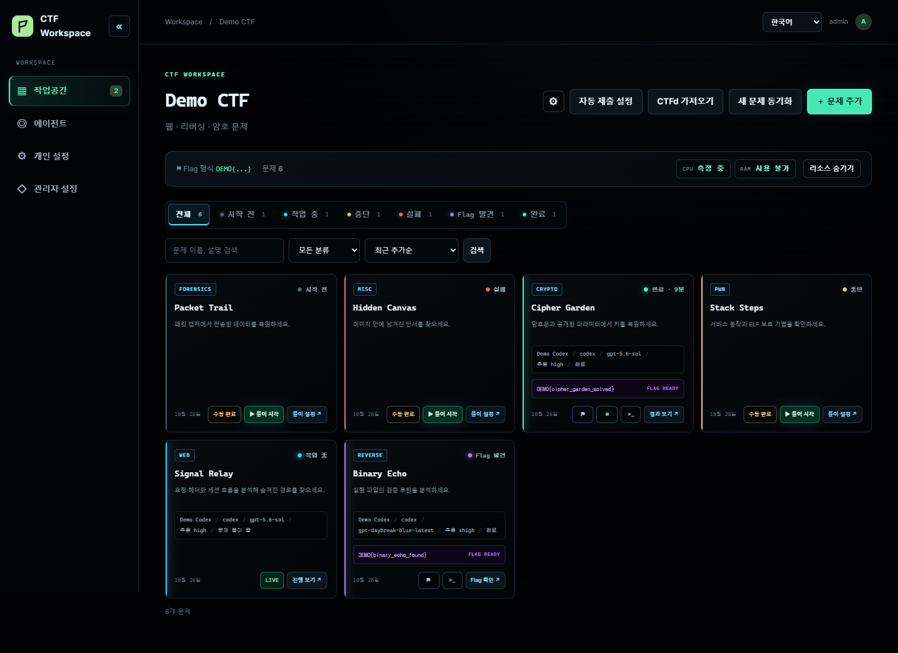
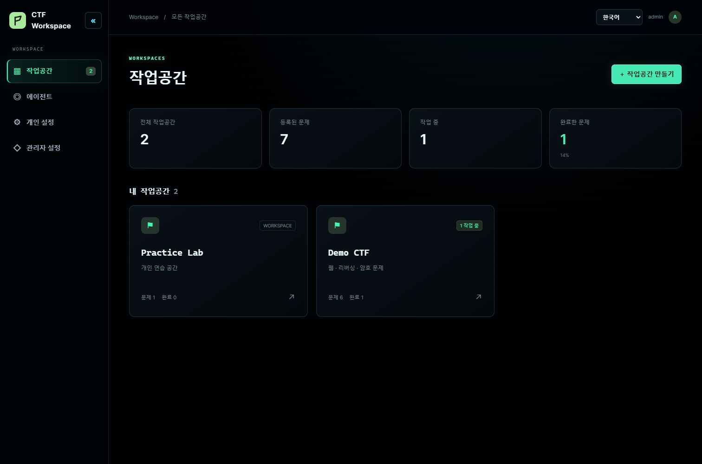
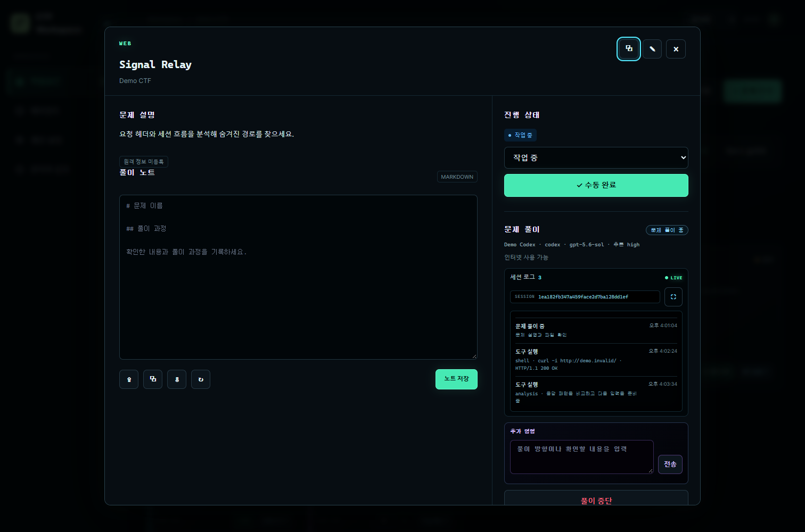
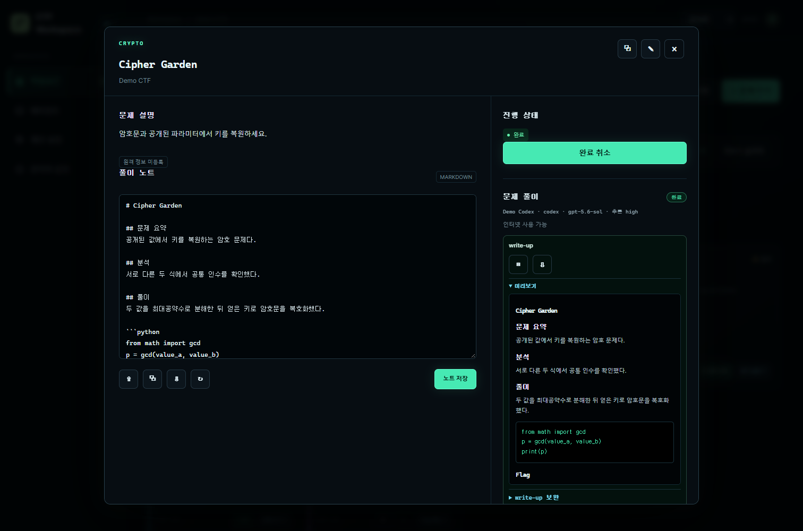
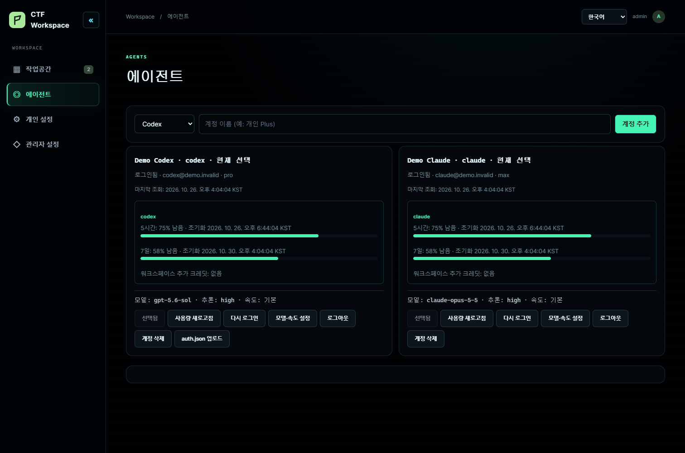
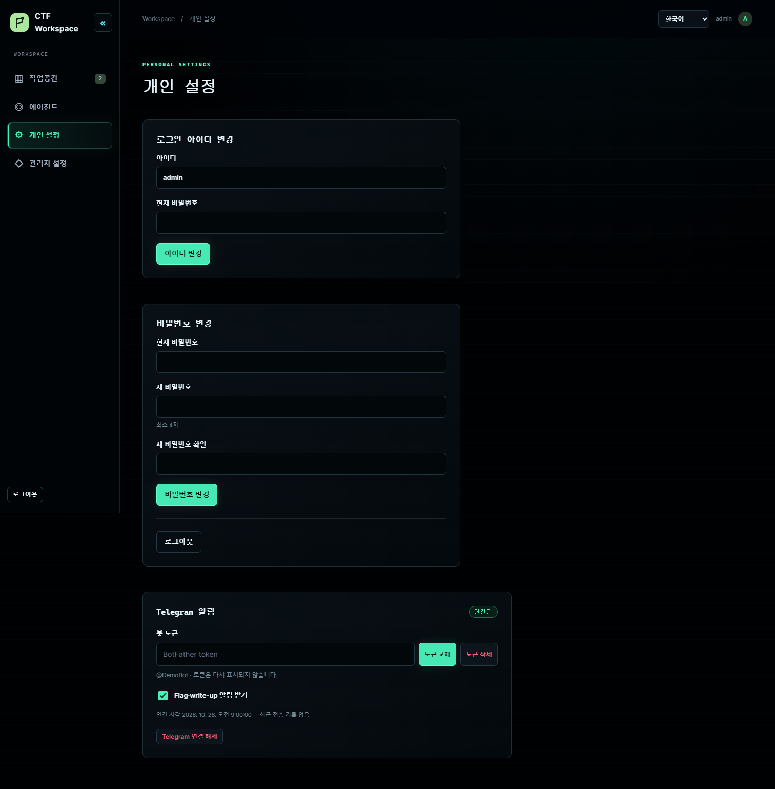
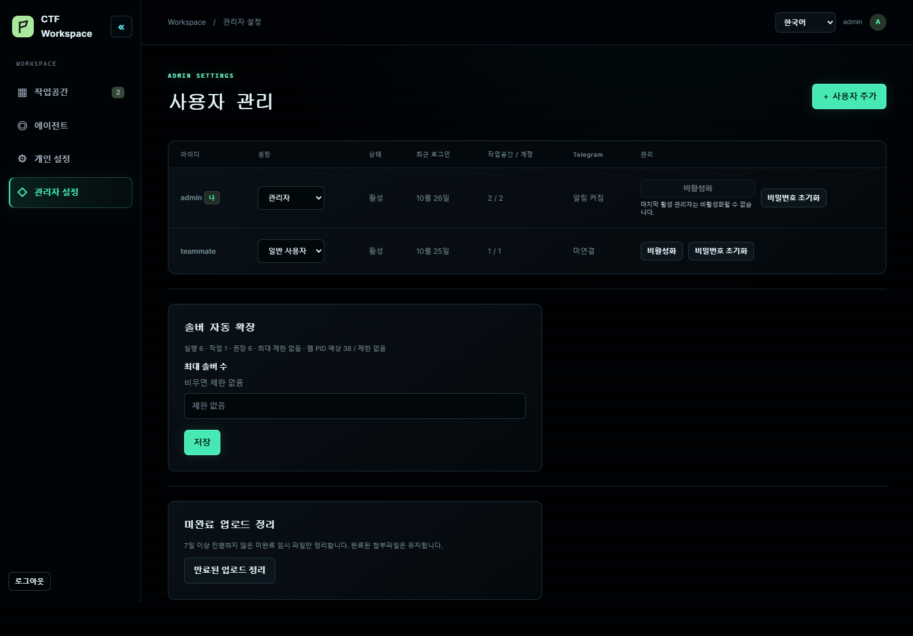

<p align="center"></p>

<h1 align="center">CTF Agent</h1>

<p align="center">CTF 문제, 풀이 세션, 파일, Flag, write-up을 작업공간별로 관리합니다.</p>

<p align="center"><a href="https://github.com/udonsari0101/CTF_Agent/releases/latest">다운로드</a> · <a href="docs/docker-desktop.md">Windows 설치 안내</a> · <a href="README.md">English</a></p>



화면에는 실제 계정이나 문제 대신 예시 데이터를 사용했습니다.

## 주요 기능

- 대회마다 작업공간을 분리합니다. 문제를 직접 등록하거나 CTFd에서 선택해 가져올 수 있으며, 이후 추가되거나 수정된 문제를 동기화할 수 있습니다. 이름이 같은 복제 문제도 고유 ID로 구분해 관련 문제를 양방향으로 연결할 수 있습니다.
- Codex와 Claude Code를 계정 로그인 또는 API 키로 연결합니다. 문제별 계정·모델·추론 수준을 선택하고, 남은 계정 사용량·진행 중인 풀이 시간·세션 활동·하위 에이전트를 확인할 수 있습니다.
- 풀이 중 추가 명령을 보낼 수 있습니다. 다시 풀 때 호환되는 공급자 세션은 직접 재개합니다. Codex와 Claude Code 사이를 전환하면 저장된 작업 파일과 범위를 제한한 분석 기록을 새 세션으로 전달하며, 노트를 쓰기 전에 중단된 경우에는 기록된 활동의 제한된 요약을 이어받습니다.
- 여러 첨부파일을 올릴 수 있습니다. 대용량 파일은 중단된 지점부터 이어 올리며, 문제 파일과 데이터베이스는 별도 데이터 디렉터리에 저장합니다.
- 풀이 상태와 발견된 Flag가 새로고침 없이 화면에 반영됩니다. 선택한 화면 언어로 Markdown write-up을 작성하며, 미리 보고 복사하거나 다운로드하고 보완을 요청할 수 있습니다.
- 각 사용자가 **개인 설정**에서 자신의 Telegram 봇 토큰을 등록하고 일회용 링크로 채팅을 연결합니다. Flag, write-up, 오류, 추가 입력 요청 알림을 받을 수 있습니다. 설치 시 봇 토큰은 필요하지 않습니다. CTFd 자동 제출은 기본적으로 꺼져 있습니다.
- 첫 실행 시 관리자 계정을 만들 수 있습니다. 여러 사용자가 함께 쓰는 로그인 모드와 명시적으로 선택하는 단일 사용자 로그인 없는 모드를 제공합니다.
- 웹 인터페이스를 한국어와 영어로 전환할 수 있습니다. 번역은 [언어팩](docs/localization.md)으로 관리합니다.

## 화면

| 작업공간 | 실시간 풀이 세션 |
| --- | --- |
|  |  |
| write-up 미리보기 | 에이전트 계정 |
|  |  |
| 개인 설정 | 관리자 설정 |
|  |  |

## Windows에 설치

1. 최신 릴리즈의 `CTF_Agent-*-local-windows.zip` 파일을 내려받아 로컬 폴더에 압축을 풉니다.
2. `Install.cmd`를 실행합니다. 설치 프로그램이 WSL 2, 적합한 Linux 배포판, Docker Desktop, 남은 디스크 공간을 확인하고 기존 방식의 WSL 데이터 경로를 제안합니다. Enter를 누르면 해당 경로를 사용합니다.
3. <http://127.0.0.1:5050>에서 첫 관리자 계정을 만들고 **에이전트** 화면에서 Codex 또는 Claude Code 계정을 연결합니다.

**관리자 설정 → 서비스 업데이트**에서 공개 릴리스와 변경 내역을 확인하고 업데이트할 수 있습니다. 기존 설치에도 `Install.cmd`를 다시 실행해 업데이트할 수 있습니다. 두 방법 모두 선택한 데이터 폴더를 유지합니다. 설치기는 서버와 동일한 커밋 고정 공개 GHCR 이미지를 내려받고 Windows 풀이 정책을 위한 작은 로컬 런타임 레이어를 빌드합니다. CTF 도구 모음은 다시 빌드하지 않습니다. 설치와 Start는 `/readyz`에서 solver 준비가 확인된 뒤 성공을 표시합니다. 자세한 요구 사항과 문제 해결 방법은 [설치 안내](docs/docker-desktop.md)를 참고하세요.

웹에서 업데이트한 뒤 Windows 실행 파일이 변경된 릴리스라면 새 ZIP의 `Install.cmd`를 한 번 실행해 Windows 사용자 폴더의 Start.cmd와 Uninstall.cmd도 갱신하세요. 웹 업데이트는 WSL 서비스를 갱신하지만, WSL interop을 사용할 수 없는 환경에서 Windows 실행 파일까지 교체하지는 못합니다.

설치 중 Windows 로그인 시 자동 실행 여부를 선택합니다. 자동 실행을 꺼도 사용자 폴더의 Start.cmd를 클릭해 시작할 수 있습니다. 같은 위치의 Uninstall.cmd는 CTF Agent 전용 컨테이너·로컬 이미지 태그·설치 릴리스를 정리합니다. 공유된 공개 이미지 캐시는 남을 수 있습니다. 선택한 데이터·DB 폴더와 WSL 배포판, Docker Desktop은 보존합니다.

Windows 파일 탐색기에서는 `\\wsl.localhost\<배포판>\<Linux 데이터 경로>\ctf_agent_data\workspace_files`로 문제 파일에 접근할 수 있습니다.

데이터 경로 입력창에 `D:\CTF-Agent\data` 같은 Windows 폴더 경로를 붙여 넣으면 `D:\CTF-Agent\data\ctf-agent-db.vhdx`를 만들어 DB만 별도 ext4 저장소에 둡니다. C:, D:, E: 등 로컬 고정 드라이브라면 선택한 WSL 배포판과 같은 드라이브도 사용할 수 있습니다. D:는 예시이며 기본값이 아닙니다. 프로그램과 문제 파일은 기존 WSL 경로를 사용합니다. Enter만 누르면 모든 데이터가 기존 WSL 경로에 남습니다. DB 파일은 `\\wsl.localhost`를 통해 파일 탐색기에서 열 수 있습니다. 기존 DB는 자동으로 이동하지 않습니다. 자세한 내용은 [Windows 설치 안내](docs/docker-desktop.md)를 참고하세요.

### 소스에서 설치

Docker Desktop의 WSL 2 통합이 활성화된 Linux 배포판 안에서 다음 명령을 실행합니다.

```sh
git clone https://github.com/udonsari0101/CTF_Agent.git ~/CTF_Agent && cd ~/CTF_Agent && CTF_AUTH_MODE=password CTF_ALLOW_WEB_BOOTSTRAP=true CTF_LOCAL_UID=$(id -u) CTF_LOCAL_GID=$(id -g) python3 deploy/local-compose.py up -d --build
```

## 문제 풀이 환경

각 solver는 별도 컨테이너와 작업 디렉터리에서 실행됩니다. 문제 설명, 첨부파일, 분야별 풀이 지침, 분석 기록을 해당 작업에 전달합니다. 분야 표기는 도구 사용을 제한하지 않습니다.

| 분야 | 제공 도구와 용도 |
| --- | --- |
| Web | `curl`, `ctf-browser`를 통한 Chromium, `ffuf`, `sqlmap`, `websocat`, Python HTTP 라이브러리: 요청, 경로, 세션, 브라우저 동작 분석 |
| Pwn | `gdb`, `gdbserver`, `pwndbg`, `pwntools`, `ROPgadget`, `ropper`, `patchelf`, `qemu-user`, `strace`: 바이너리 분석과 익스플로잇 재현 |
| Reverse | Ghidra headless, JADX, `radare2`, `objdump`, `readelf`, `angr`, LIEF, Capstone, Unicorn, `apktool`, `wabt`: 네이티브, Android, WebAssembly 분석 |
| Crypto | PARI/GP, PyCryptodome, SymPy, `gmpy2`, Z3, `fpylll`, `owiener`, `john`: 대수, 격자, RSA, 암호 문제 |
| Forensics | `binwalk`, `foremost`, `exiftool`, Sleuth Kit, `testdisk`, Volatility 3, `tshark`, YARA, `ffmpeg`, `steghide`, `stegseek`: 파일, 디스크, 메모리, 패킷, 미디어, 스테가노그래피 분석 |
| Network 및 기타 | `dig`, `whois`, `nmap`, Scapy, `socat`, `tesseract`, `zbarimg`, Python: 프로토콜, 자동화, OCR |

[REA](https://github.com/morluto/rea)는 기본 이미지에 포함되지 않습니다. REA는 분석 도구를 연결하는 선택적 MCP 인터페이스이며, Ghidra와 JADX는 이미지에서 직접 사용할 수 있습니다. 버전과 설치 범위는 [도구 목록](docs/ctf-toolchain.md)을 참고하세요. GPU와 KVM 같은 호스트 기능은 로컬 Docker 설정에 따라 사용할 수 있습니다.
