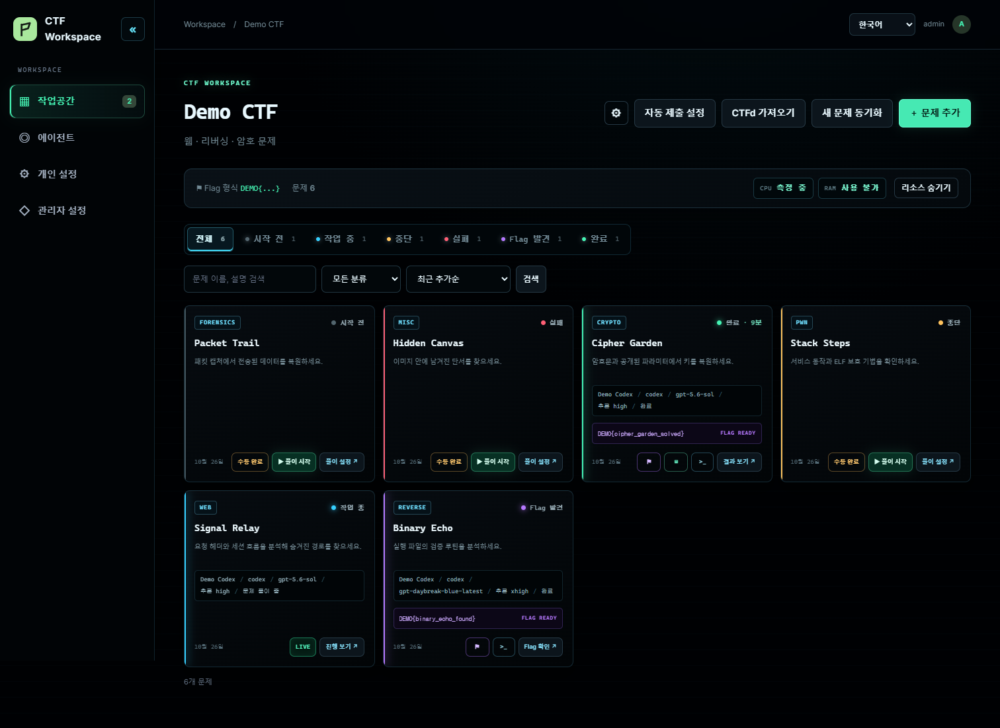
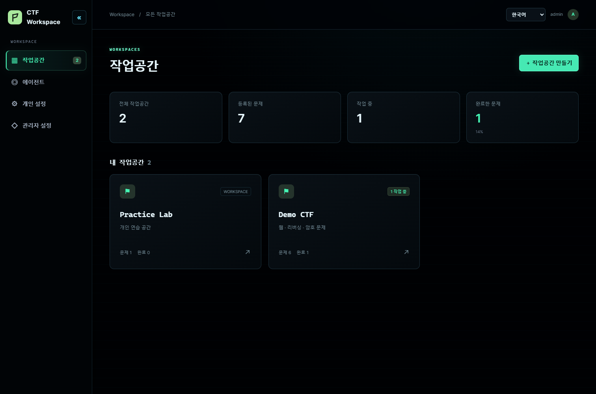
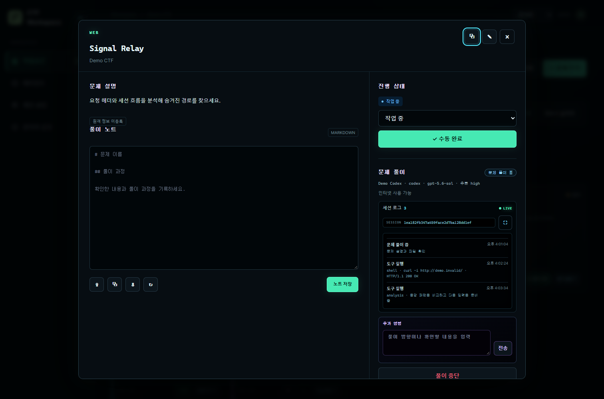
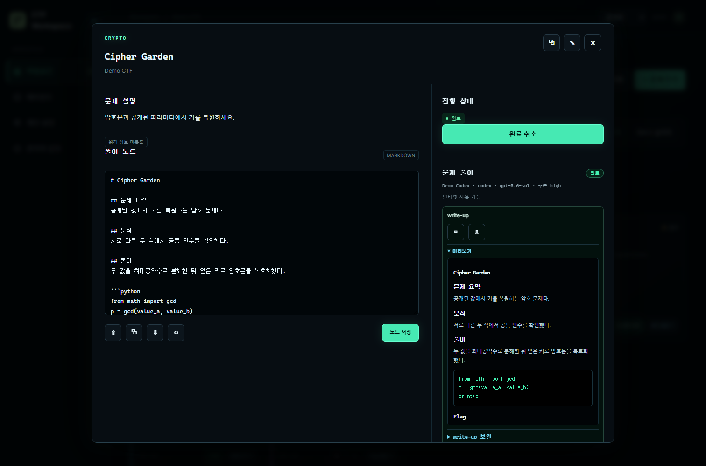
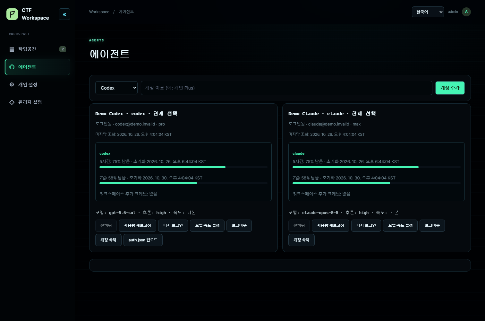
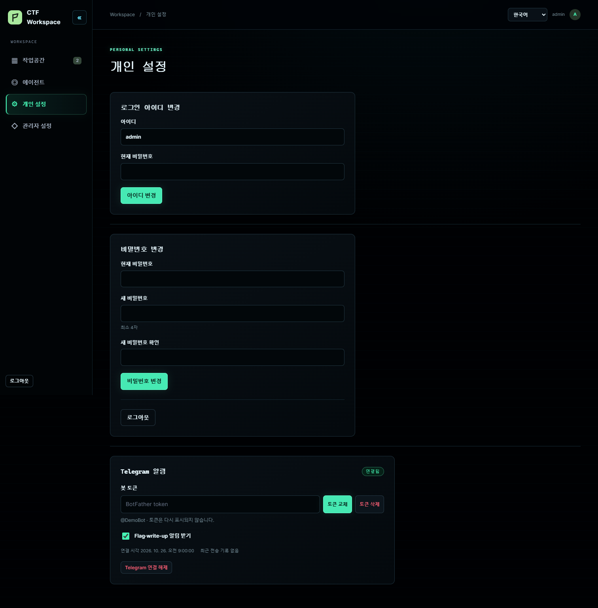
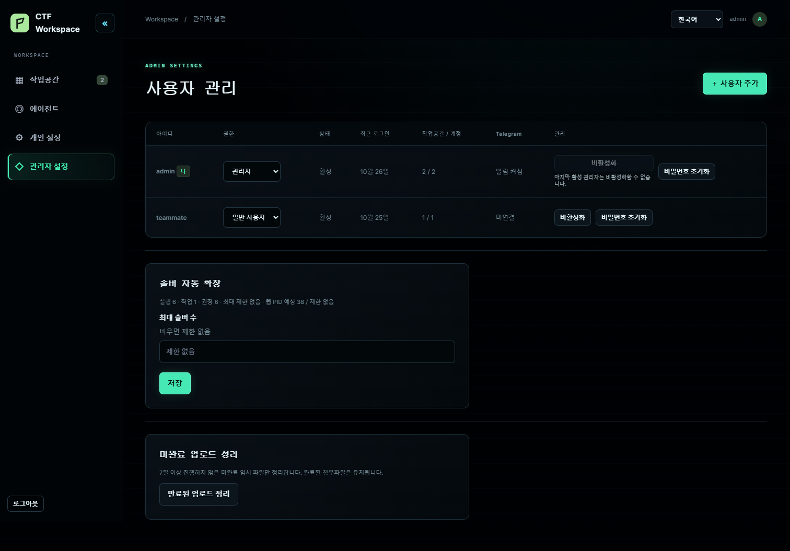

<p align="center"></p>

<h1 align="center">CTF Agent</h1>

<p align="center">CTF 문제, 풀이 세션, 파일, Flag, write-up을 작업공간별로 관리합니다.</p>

<p align="center"><a href="https://github.com/udonsari0101/CTF_Agent/releases/latest">다운로드</a> · <a href="docs/guides/docker-desktop.md">Windows 설치 안내</a> · <a href="docs/README.md">문서 목록</a> · <a href="README.md">English</a></p>



화면에는 실제 계정이나 문제 대신 예시 데이터를 사용했습니다.

## 주요 기능

- 대회마다 작업공간을 분리합니다. 작업공간 설정에서 CTFd 주소와 API 토큰 또는 아이디·비밀번호를 저장해 문제 가져오기와 선택적 Flag 자동 제출에 함께 사용할 수 있습니다. 가져올 때 새 인증 정보를 일회성으로 입력할 수도 있습니다. 문제를 직접 등록하거나 CTFd에서 선택해 가져올 수 있으며, 이후 추가되거나 수정된 문제를 동기화할 수 있습니다. 이름이 같은 복제 문제도 고유 ID로 구분해 관련 문제를 양방향으로 연결할 수 있습니다.
- Codex와 Claude Code를 계정 로그인 또는 API 키로 연결합니다. 문제별 계정·모델·추론 수준을 선택하고, 계정 연결 방식에서 지원하는 경우 남은 사용량과 진행 중인 풀이 시간·세션 활동·하위 에이전트를 확인할 수 있습니다.
- 풀이 중 추가 명령을 보낼 수 있습니다. 다시 풀 때 호환되는 공급자 세션은 직접 재개합니다. Codex와 Claude Code 사이를 전환하면 저장된 작업 파일과 범위를 제한한 분석 기록을 새 세션으로 전달하며, 노트를 쓰기 전에 중단된 경우에는 기록된 활동의 제한된 요약을 이어받습니다.
- 여러 첨부파일을 올릴 수 있습니다. 대용량 파일은 중단된 지점부터 이어 올리며, 문제 파일과 데이터베이스는 별도 데이터 디렉터리에 저장합니다.
- 풀이 상태와 발견된 Flag가 새로고침 없이 화면에 반영됩니다. 선택한 화면 언어로 Markdown write-up을 작성하며, 미리 보고 복사하거나 다운로드하고 보완을 요청할 수 있습니다.
- 각 사용자가 **개인 설정**에서 자신의 Telegram 봇 토큰을 등록하고 일회용 링크로 채팅을 연결합니다. Flag, write-up, 오류, 추가 입력 요청 알림을 받을 수 있습니다. 설치 시 봇 토큰은 필요하지 않습니다. CTFd 자동 제출은 기본적으로 꺼져 있습니다.
- 첫 실행 시 관리자 계정을 만들 수 있습니다. 여러 사용자가 함께 쓰는 로그인 모드와 명시적으로 선택하는 단일 사용자 로그인 없는 모드를 제공합니다.
- 웹 인터페이스를 한국어와 영어로 전환할 수 있습니다. 번역은 [언어팩](docs/guides/localization.md)으로 관리합니다.

작업공간 또는 문제를 다른 설치본으로 옮길 때 ZIP 파일을 내려받아 가져오거나 선택적으로 HTTPS 직접 전송을 사용할 수 있습니다. 문제 자료와 함께 풀이 세션 로그를 읽기 전용 이력으로 옮깁니다. 계정 인증 정보와 재개 가능한 공급자 세션은 원본 설치본에 남습니다. 공개 HTTPS 주소가 없는 로컬 설치본이나 Cloudflare Access로 보호된 대상에는 수동 ZIP 방식을 사용하세요. 설정과 재시도 방법은 [전송 안내](docs/guides/workspace-transfer.md)를 참고하세요.

## 화면

| 작업공간 | 실시간 풀이 세션 |
| --- | --- |
|  |  |
| write-up 미리보기 | 에이전트 계정 |
|  |  |
| 개인 설정 | 관리자 설정 |
|  |  |

## Windows에 설치

1. 최신 릴리즈의 `CTF_Agent-*-local-windows.zip` 파일을 내려받아 로컬 폴더에 압축을 풉니다.
2. `Install.cmd`를 실행합니다. 설치 프로그램이 WSL 2, 적합한 Linux 배포판, Docker Desktop, 남은 디스크 공간을 확인하고 기존 방식의 WSL 데이터 경로를 제안합니다. Enter를 누르면 해당 경로를 사용합니다.
3. <http://127.0.0.1:5050>에 접속합니다. 비밀번호 로그인 모드를 선택했다면 첫 관리자 계정을 만듭니다. 명시적으로 선택한 로그인 없는 모드에서는 이 단계가 없습니다. **에이전트** 화면에서 Codex 또는 Claude Code 계정을 연결합니다.

기존 WSL 배포판에서 자체 Docker Engine을 실행 중이면 배포판 선택 화면에서 **N**을 입력해 Docker Desktop용 Ubuntu를 새로 만드세요. Linux 사용자 이름과 비밀번호를 설정한 뒤 Linux 창에서 `exit`를 입력하면 설치기가 계속 진행됩니다.

**관리자 설정 → 서비스 업데이트**에서 공개 릴리스와 변경 내역을 확인하고 업데이트할 수 있습니다. 기존 설치에도 `Install.cmd`를 다시 실행해 업데이트할 수 있습니다. 두 방법 모두 선택한 데이터 폴더를 유지합니다. 설치기는 서버와 동일한 커밋 고정 공개 GHCR 이미지를 내려받고 Windows 풀이 정책을 위한 작은 로컬 런타임 레이어를 빌드합니다. CTF 도구 모음은 다시 빌드하지 않습니다. 설치와 Start는 `/readyz`에서 solver 준비가 확인된 뒤 성공을 표시합니다. 자세한 요구 사항과 문제 해결 방법은 [설치 안내](docs/guides/docker-desktop.md)를 참고하세요.

웹에서 업데이트한 뒤 Windows 실행 파일이 변경된 릴리스라면 새 ZIP의 `Install.cmd`를 한 번 실행해 Windows 사용자 폴더의 Start.cmd와 Uninstall.cmd도 갱신하세요. 웹 업데이트는 WSL 서비스를 갱신하지만, WSL interop을 사용할 수 없는 환경에서 Windows 실행 파일까지 교체하지는 못합니다. DB를 Windows 드라이브의 별도 VHDX에 저장한 기존 설치는 새 릴리스의 `Install.cmd`를 한 번 실행해 검증된 Docker DB 경로로 이전한 뒤 웹 업데이트를 사용하세요.

설치 중 Windows 로그인 시 자동 실행 여부를 선택합니다. 자동 실행을 꺼도 사용자 폴더의 Start.cmd를 클릭해 시작할 수 있습니다. 같은 위치의 Uninstall.cmd는 CTF Agent 전용 컨테이너·로컬 이미지 태그·설치 릴리스를 정리합니다. 공유된 공개 이미지 캐시는 남을 수 있습니다. 선택한 데이터·DB 폴더와 WSL 배포판, Docker Desktop은 보존합니다.

Windows 파일 탐색기에서는 `\\wsl.localhost\<배포판>\<Linux 데이터 경로>\ctf_agent_data\workspace_files`로 문제 파일에 접근할 수 있습니다.

데이터 경로 입력창에 `D:\CTF-Agent\data` 같은 Windows 폴더 경로를 붙여 넣으면 `D:\CTF-Agent\data\ctf-agent-db.vhdx`를 만들어 DB만 별도 ext4 저장소에 둡니다. C:, D:, E: 등 로컬 고정 드라이브라면 선택한 WSL 배포판과 같은 드라이브도 사용할 수 있습니다. D:는 예시이며 기본값이 아닙니다. 프로그램과 문제 파일은 기존 WSL 경로를 사용합니다. Enter만 누르면 모든 데이터가 기존 WSL 경로에 남습니다. DB 파일은 `\\wsl.localhost`를 통해 파일 탐색기에서 열 수 있습니다. 기존 DB는 자동으로 이동하지 않습니다. 자세한 내용은 [Windows 설치 안내](docs/guides/docker-desktop.md)를 참고하세요.

### 소스에서 설치

Docker Desktop의 WSL 2 통합이 활성화된 Linux 배포판 안에서 다음 명령을 실행합니다.

```sh
git clone https://github.com/udonsari0101/CTF_Agent.git ~/CTF_Agent && cd ~/CTF_Agent && CTF_AUTH_MODE=password CTF_ALLOW_WEB_BOOTSTRAP=true CTF_LOCAL_UID=$(id -u) CTF_LOCAL_GID=$(id -g) python3 deploy/local-compose.py up -d --build
```

## 문제 풀이 환경

각 solver는 별도 컨테이너와 작업 디렉터리에서 실행됩니다. 문제 설명, 첨부파일, 분야별 풀이 지침, 분석 기록을 해당 작업에 전달합니다. 분야 표기는 도구 사용을 제한하지 않습니다.

| 분야 | 제공 도구와 용도 |
| --- | --- |
| Web | `curl`, `ctf-browser`를 통한 Chromium, `ffuf`, `sqlmap`, `websocat`, Python HTTP 라이브러리: 요청, 경로, 세션, 브라우저 동작 분석 |
| Pwn | `gdb`, `gdbserver`, `pwndbg`, `pwntools`, `ROPgadget`, `ropper`, `patchelf`, `qemu-user`, `strace`: 바이너리 분석과 익스플로잇 재현 |
| Reverse | Ghidra headless, JADX, `radare2`, `objdump`, `readelf`, `angr`, LIEF, Capstone, Unicorn, `apktool`, `wabt`: 네이티브, Android, WebAssembly 분석 |
| Crypto | PARI/GP, PyCryptodome, SymPy, `gmpy2`, Z3, `fpylll`, `owiener`, `john`: 대수, 격자, RSA, 암호 문제 |
| Forensics | `binwalk`, `foremost`, `exiftool`, Sleuth Kit, `testdisk`, Volatility 3, `tshark`, YARA, `ffmpeg`, `steghide`, `stegseek`: 파일, 디스크, 메모리, 패킷, 미디어, 스테가노그래피 분석 |
| Network 및 기타 | `dig`, `whois`, `nmap`, Scapy, `socat`, `tesseract`, `zbarimg`, Python: 프로토콜, 자동화, OCR |

[REA](https://github.com/morluto/rea)는 기본 이미지에 포함되지 않습니다. REA는 분석 도구를 연결하는 선택적 MCP 인터페이스이며, Ghidra와 JADX는 이미지에서 직접 사용할 수 있습니다. 기본 solver 컨테이너에는 호스트 GPU나 KVM 장치가 마운트되지 않습니다. 버전과 실행 범위는 [도구 목록](docs/guides/ctf-toolchain.md)을 참고하세요.

## 참고 자료

아래 저장소와 연구를 설계 검토에 참고했습니다. 해당 구현을 포함했다는 뜻이 아니며, 논문의 풀이율은 CTF Agent의 성능 수치가 아닙니다.

- **에이전트 조정과 이어풀기:** [ctf-solver-agent](https://github.com/yakisoba0728/ctf-solver-agent)(solver 조정), [ctfsolver](https://github.com/hongyime/ctfsolver)(파일 기반 인수인계), [Muteki](https://github.com/FishCodeTech/muteki)(증거가 연결된 관측), [Veria Labs ctf-agent](https://github.com/verialabs/ctf-agent)(병렬 worker와 오답 제출 대기). 구현을 가져오지 않고 설계를 비교했습니다.
- **도구 사용과 실패 분석:** [EnIGMA](https://proceedings.mlr.press/v267/abramovich25a.html)(대화형 도구와 실제 출력), [PwnAgent](https://link.springer.com/article/10.1186/s42400-026-00649-5)(디버거 피드백), [Reveree](https://arxiv.org/html/2609.01185)(리버싱 단계별 진척), [A Second Look](https://arxiv.org/html/2605.21497)(조정 구조의 시간·비용 균형).
- **평가 설계:** [Baselines Before Architecture](https://arxiv.org/html/2607.13085)([재현 자료](https://github.com/krodalabs/coding-agent-research-artifact))는 같은 모델·예산의 기본 CLI 대조군 필요성을 보여줍니다. 과거 XBOW 웹 실험 수치를 일반 CTF 성능으로 보지 않습니다. [CTFusion](https://github.com/kaist-hacking/CTFusion)은 격리된 실전 대회 비교를, [CTF-ABACUS](https://arxiv.org/html/2608.26237)는 Flag 출처 감사를 참고하게 합니다.
- **공개 평가 자료:** [NYU CTF Bench](https://github.com/NYU-LLM-CTF/NYU_CTF_Bench)는 공개 개발/시험 분할, [Cybench](https://github.com/andyzorigin/cybench)는 부분 과제, [CTFTiny](https://github.com/NYU-LLM-CTF/CTFTiny)는 작은 회귀 확인에 쓸 수 있습니다. [CTF-Dojo](https://proceedings.mlr.press/v306/zhuo26c.html)의 보고 개선치는 모델 학습 결과이지 실행 하네스 효과가 아닙니다. 공개 정답은 학습이나 검색으로 알려졌을 수 있으므로 향후 실전 결과는 별도로 보고해야 합니다.

## 출처와 반영 항목

아래 표는 실제 탑재한 도구·프로토콜 연동과 설계 비교를 구분합니다. CTF Agent의 작업 조정·평가 코드는 독립적으로 구현했으며, 인용한 외부 에이전트의 코드를 복사하지 않았습니다. 평가 도구가 준비된 것과 모델 벤치마크가 끝난 것은 다릅니다.

| 출처 | 반영·비교한 내용 | 이 저장소의 위치 |
| --- | --- | --- |
| [CTFd](https://github.com/CTFd/CTFd) | CTFd 호환 API로 문제·첨부파일을 가져오고 나중에 동기화하며, 선택적으로 Flag를 제출합니다. | [CTFd 클라이언트](ctf_agent/ctfd.py)와 [제출 작업자](ctf_agent/ctfd_submit.py). 프로토콜 직접 연동이며 자동 제출은 기본적으로 꺼져 있습니다. |
| [Ghidra](https://github.com/NationalSecurityAgency/ghidra)·[JADX](https://github.com/skylot/jadx) | solver 이미지에 네이티브 및 Android/DEX용 헤드리스 디컴파일 명령을 제공합니다. | [도구 이미지](Dockerfile.toolchain)와 [이미지 작동 검사](deploy/image-smoke.py). 상위 도구를 설치했으며 에이전트 구현을 가져오지는 않았습니다. |
| [Pwndbg](https://github.com/pwndbg/pwndbg) | Pwn 문제에서 GDB 기반 바이너리 분석을 지원합니다. | [도구 이미지](Dockerfile.toolchain)와 [이미지 작동 검사](deploy/image-smoke.py). 상위 도구를 설치했습니다. |
| [ctfsolver](https://github.com/hongyime/ctfsolver) | CTFd 문제를 도구가 준비된 격리 에이전트 컨테이너에 전달하는 흐름을 비교했습니다. | [CTFd 클라이언트](ctf_agent/ctfd.py)와 [풀이 작업자](ctf_agent/solver_worker.py). 독립적인 작업 흐름이며 상위 에이전트 코드를 가져오지 않았습니다. |
| [CTFusion](https://github.com/kaist-hacking/CTFusion) | 독립 시도와 로컬 Flag 발견·공식 CTFd 제출의 분리를 평가 기준에 반영했습니다. | [벤치마크 절차](docs/benchmarking/protocol.md)와 [제출 작업자](ctf_agent/ctfd_submit.py). 설계 참고이며 실전 벤치마크 결과를 주장하지 않습니다. |
| [Baselines Before Architecture](https://arxiv.org/html/2607.13085) ([재현 자료](https://github.com/krodalabs/coding-agent-research-artifact)) | 같은 모델·예산의 기본 공급자 CLI를 하네스 비교의 대조군으로 둡니다. | [벤치마크 절차](docs/benchmarking/protocol.md), [계획 검사기](scripts/benchmark_plan.py), [결과 검사기](scripts/benchmark_report.py). 평가 방법만 준비됐고 실제 시행은 남아 있습니다. |
| [NYU CTF Bench](https://github.com/NYU-LLM-CTF/NYU_CTF_Bench)·[Cybench](https://github.com/andyzorigin/cybench) | 재현 가능한 문제 입력, 별도 정답 판정, 분야별 결과 기록을 벤치마크 매니페스트에 참고했습니다. | [벤치마크 절차](docs/benchmarking/protocol.md)와 [사전 감사](docs/benchmarking/preflight-audit.md). 해당 문제셋은 이 저장소에 포함하지 않습니다. |
