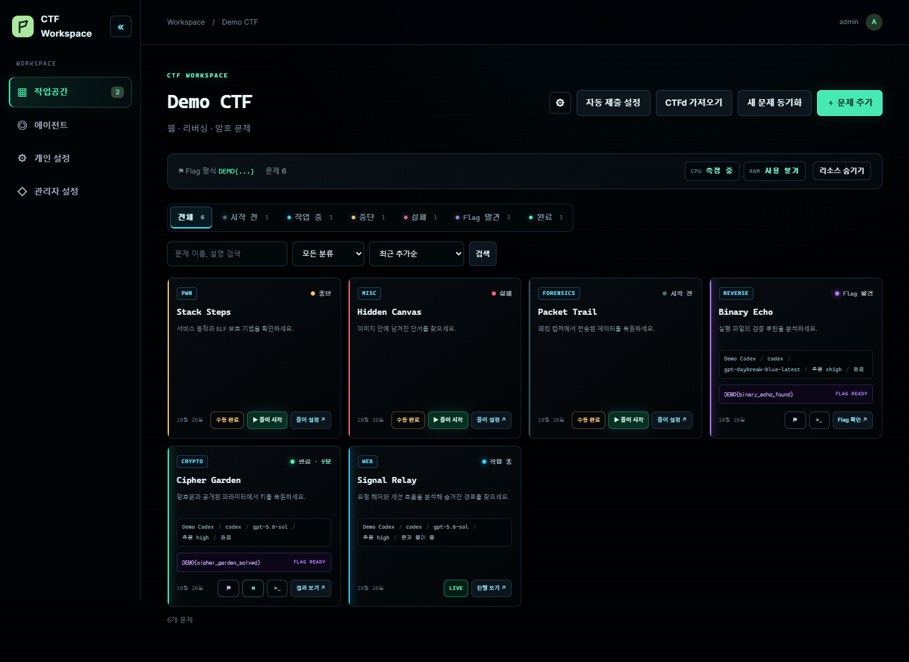
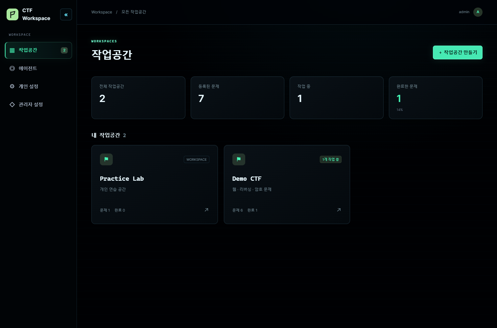
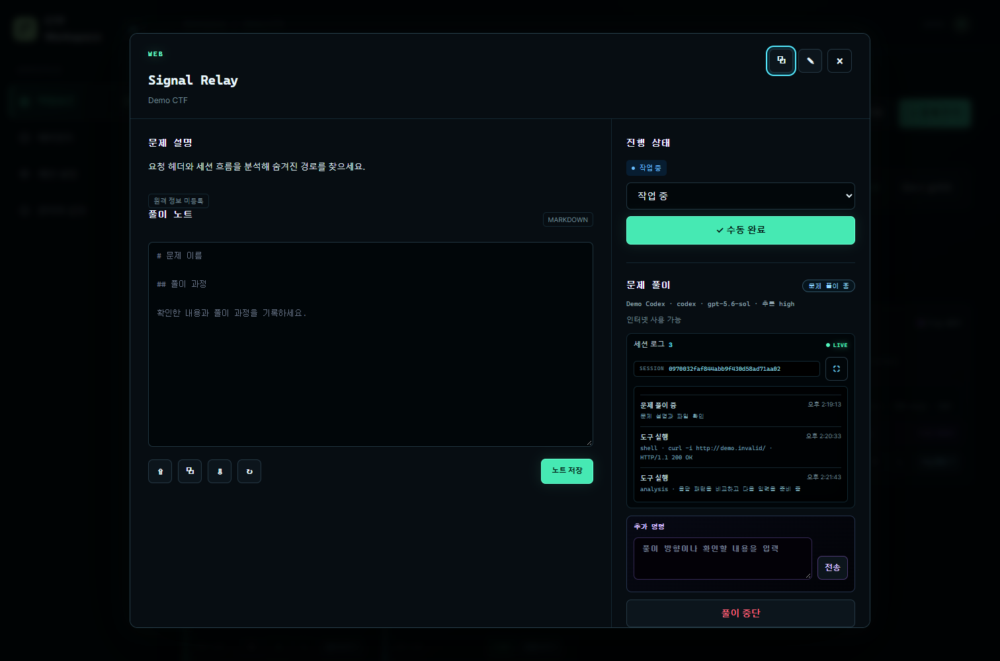
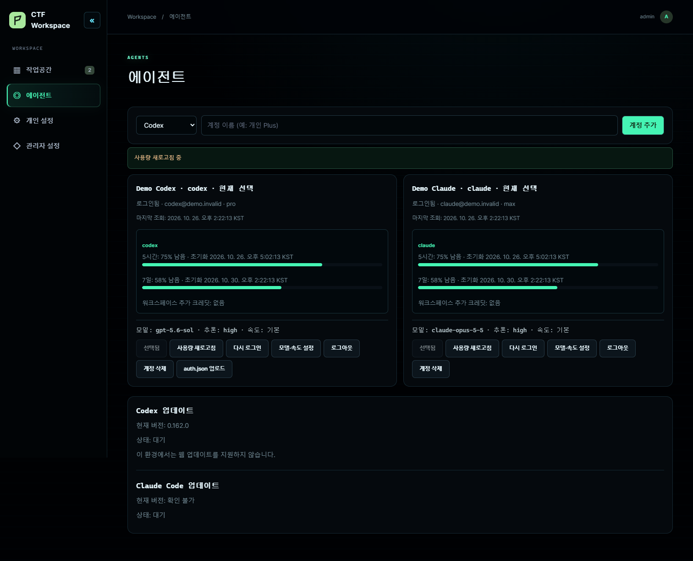
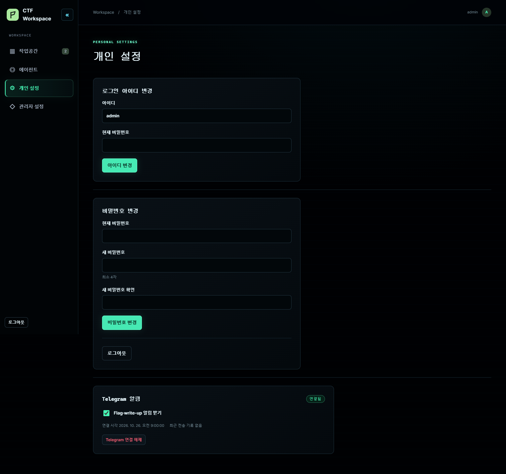
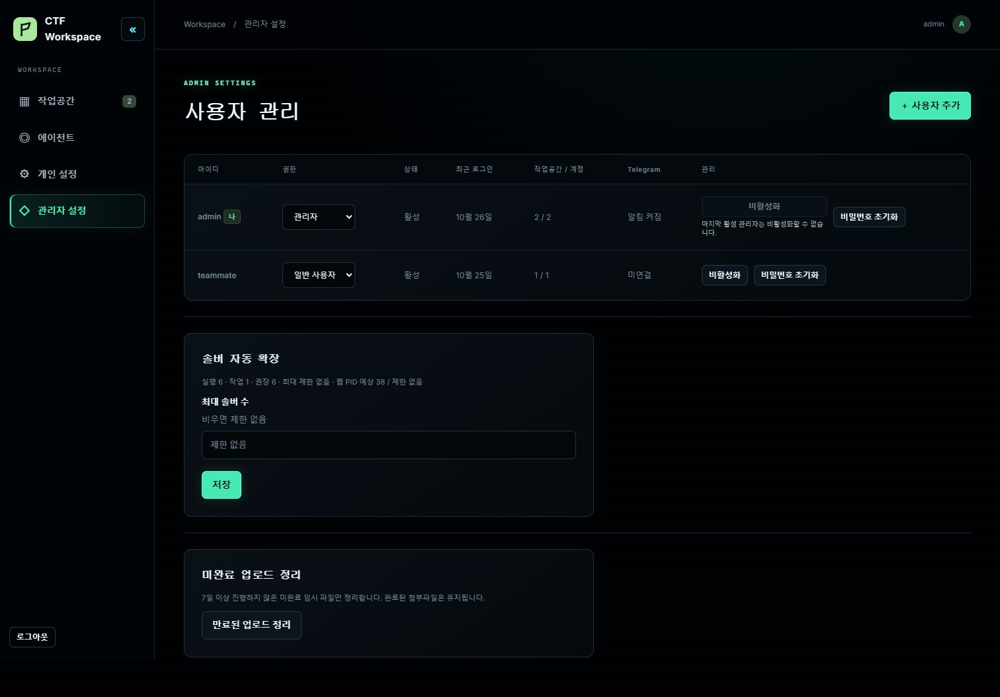

<p align="center"></p>

<h1 align="center">CTF Agent</h1>

<p align="center">A workspace for CTF challenges, solver sessions, files, flags, and write-ups.</p>

<p align="center"><a href="https://github.com/udonsari0101/CTF_Agent/releases/latest">Download</a> · <a href="docs/docker-desktop.md">Windows installation</a> · <a href="#한국어">한국어</a></p>



The screenshots use synthetic challenges and account data.

## Features

- Keep each CTF in a separate workspace. Add challenges manually or import selected challenges from CTFd; sync new or changed challenges later.
- Connect Codex and Claude Code accounts. Choose an account, model, and reasoning level for each challenge, then watch the session log and send follow-up instructions while it runs.
- Upload multiple files, including large binaries with resumable transfers. Challenge files and the database use separate data directories.
- See flags as soon as they are found. Review, copy, and download Korean Markdown write-ups; request a revised write-up when needed.
- Optionally connect Telegram for flag, write-up, error, and input-request notifications. CTFd flag submission is off by default.
- Use the first-run administrator setup for a multi-user installation. A separate no-login mode is available for explicitly configured single-user instances.
- Switch the web interface between English and Korean. Interface translations live in [language packs](docs/localization.md) so more languages can be added.

## Screenshots

| Workspaces | Live solver session |
| --- | --- |
|  |  |
| Write-up preview | Agent accounts |
|  |  |
| Personal settings | Administration |
|  |  |

## Install on Windows

1. Download the latest `CTF_Agent-*-local-windows.zip` release and extract it to a local folder.
2. Run `Install.cmd`. The installer checks WSL 2, suggests a suitable Linux distribution, checks Docker Desktop and available disk space, then asks where to keep your data inside WSL.
3. Open <http://127.0.0.1:5050> and create the first administrator account. Connect a Codex or Claude Code account in **Agents**.

Run `Install.cmd` from a newer release to upgrade. The installer preserves the selected data directory. The first image build downloads a large CTF toolchain; subsequent application updates reuse it when the toolchain has not changed. See the [installation guide](docs/docker-desktop.md) for requirements, troubleshooting, and Windows Explorer access to challenge files.

To open your challenge files from Windows, use Explorer at `\\wsl.localhost\<distribution>\<Linux data path>\ctf_agent_data\workspace_files`.

### Install from source

Run this line inside a WSL 2 distribution with Docker Desktop integration enabled:

```sh
git clone https://github.com/udonsari0101/CTF_Agent.git ~/CTF_Agent && cd ~/CTF_Agent && CTF_AUTH_MODE=password CTF_ALLOW_WEB_BOOTSTRAP=true CTF_LOCAL_UID=$(id -u) CTF_LOCAL_GID=$(id -g) python3 deploy/local-compose.py up -d --build
```

## Solver environment

Each solver runs in a separate container with its own scratch space. The challenge brief, attachments, category playbooks, and analysis notes are assembled for that job. The solver may use the tools relevant to the challenge; a category label is a hint rather than a constraint.

| Field | Available tools and typical uses |
| --- | --- |
| Web | `curl`, Chromium via `ctf-browser`, `ffuf`, `sqlmap`, `websocat`, Python HTTP libraries: request inspection, paths, sessions, and browser behavior. |
| Pwn | `gdb`, `gdbserver`, `pwndbg`, `pwntools`, `ROPgadget`, `ropper`, `patchelf`, `qemu-user`, `strace`: binary behavior and exploit reproduction. |
| Reverse | Ghidra headless, JADX, `radare2`, `objdump`, `readelf`, `angr`, LIEF, Capstone, Unicorn, `apktool`, `wabt`: native, Android, and WebAssembly analysis. |
| Crypto | PARI/GP, PyCryptodome, SymPy, `gmpy2`, Z3, `fpylll`, `owiener`, `john`: algebra, lattice, RSA, and password challenges. |
| Forensics | `binwalk`, `foremost`, `exiftool`, Sleuth Kit, `testdisk`, Volatility 3, `tshark`, YARA, `ffmpeg`, `steghide`, `stegseek`: file, disk, memory, traffic, media, and steganography analysis. |
| Network and misc | `dig`, `whois`, `nmap`, Scapy, `socat`, `tesseract`, `zbarimg`, Python: protocol inspection, automation, and OCR. |

See the [toolchain inventory](docs/ctf-toolchain.md) for version and availability details. Optional host features such as GPU and KVM depend on the local Docker setup.

## Development

```sh
python -m pip install -r requirements-dev.txt
python -m pytest -q
```

## 한국어

CTF Agent는 대회별 작업공간에서 문제, 첨부파일, 풀이 세션, Flag, write-up을 관리하는 웹 서비스입니다. 문제는 직접 등록하거나 CTFd에서 선택해 가져올 수 있습니다. Codex와 Claude Code 계정·모델을 문제별로 지정하고, 풀이 로그를 보거나 실행 중 추가 지시를 보낼 수 있습니다.

웹 화면은 영어와 한국어를 전환할 수 있습니다. 추가 언어는 [언어팩 안내](docs/localization.md)에 따라 등록합니다.

Windows에서는 [최신 릴리스](https://github.com/udonsari0101/CTF_Agent/releases/latest)의 ZIP을 풀고 `Install.cmd`를 실행하세요. 설치 중 WSL 배포판과 데이터 경로를 선택합니다. 첫 접속에서 관리자 계정을 만듭니다. 자세한 내용은 [설치 안내](docs/docker-desktop.md)를 참고하세요.
