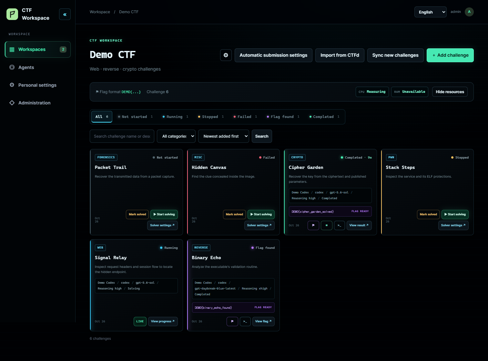
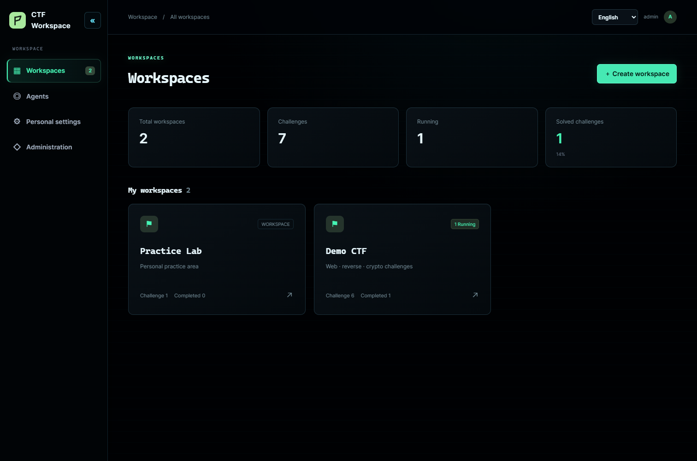
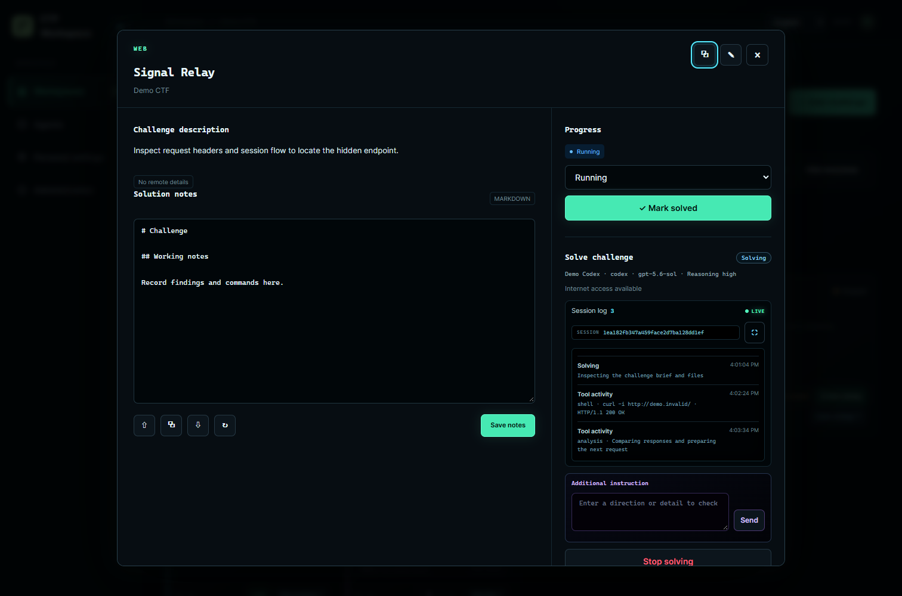
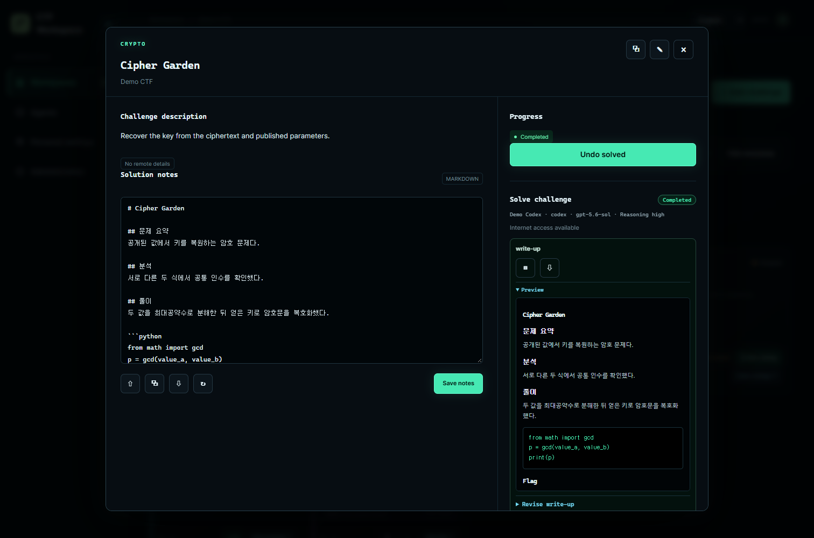
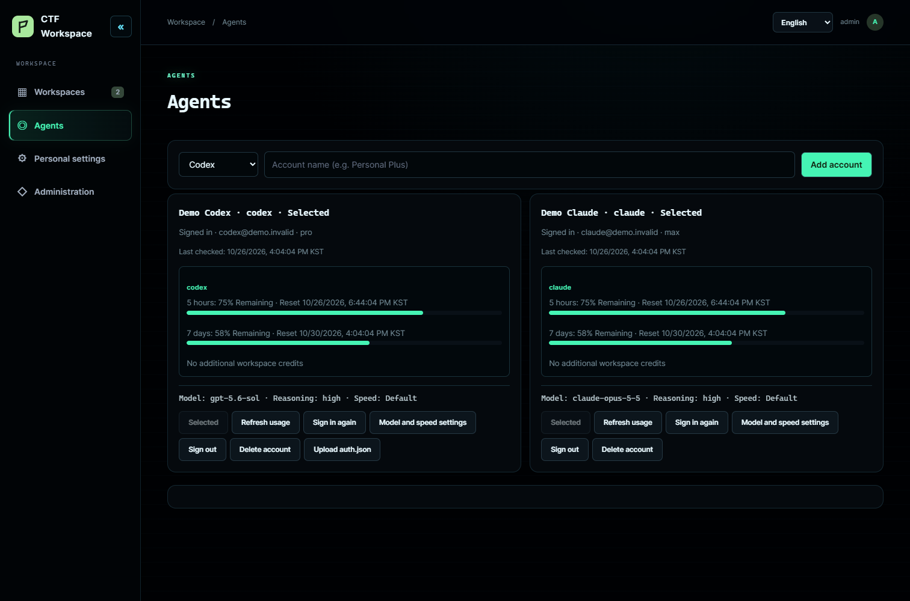
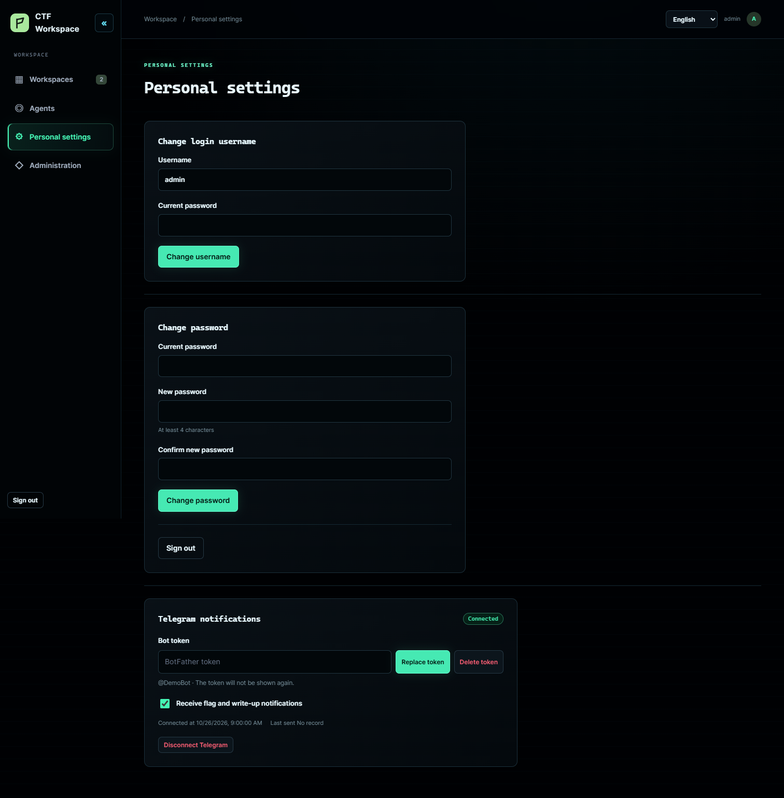
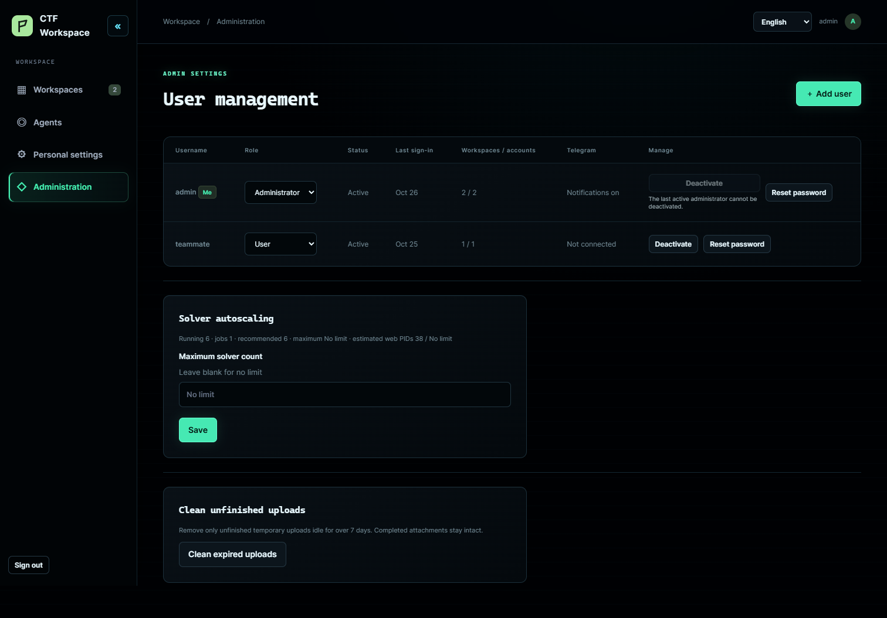

<p align="center"></p>

<h1 align="center">CTF Agent</h1>

<p align="center">A workspace for CTF challenges, solver sessions, files, flags, and write-ups.</p>

<p align="center"><a href="https://github.com/udonsari0101/CTF_Agent/releases/latest">Download</a> · <a href="docs/docker-desktop.md">Windows installation</a> · <a href="README.ko.md">한국어</a></p>



The screenshots use synthetic challenges and account data.

## Features

- Keep each CTF in a separate workspace. Add challenges manually or import selected challenges from CTFd; sync new or changed challenges later. Link related challenges by ID, including challenges with duplicate names.
- Connect Codex and Claude Code through account sign-in or an API key. Choose the account, model, and reasoning level per challenge; see remaining account quota, live solve time, session activity, and child agents.
- Send instructions during a solve. On retry, a compatible provider session can resume directly. Switching between Codex and Claude Code carries available work files and bounded analysis notes into a new session; if a run stops before it writes notes, a bounded summary of its recorded activity supplies the retry context.
- Upload multiple files, including large binaries with resumable transfers. Challenge files and the database use separate data directories.
- See status and flags update while a solve runs, without refreshing the page. Review, copy, and download Markdown write-ups in the selected interface language; request a revised write-up when needed.
- Each user can register a Telegram bot token in **Personal settings**, connect a chat through a one-time link, and receive flag, write-up, error, and input-request notifications. No bot token is bundled or required during installation. CTFd flag submission is off by default.
- Use the first-run administrator setup for a multi-user installation. A separate no-login mode is available for explicitly configured single-user instances.
- Switch the web interface between English and Korean. Interface translations live in [language packs](docs/localization.md) so more languages can be added.

## Screenshots

| Workspaces | Live solver session |
| --- | --- |
|  |  |
| Write-up preview | Agent accounts |
|  |  |
| Personal settings | Administration |
|  |  |

## Install on Windows

1. Download the latest `CTF_Agent-*-local-windows.zip` release and extract it to a local folder.
2. Run `Install.cmd`. The installer checks WSL 2, suggests a suitable Linux distribution, checks Docker Desktop and available disk space, then offers the usual data path inside WSL. Press Enter to use it.
3. Open <http://127.0.0.1:5050> and create the first administrator account. Connect a Codex or Claude Code account in **Agents**.

Open **Administration → Service updates** to check public releases, read release notes, and install an update. `Install.cmd` can also update an existing installation. Both paths preserve the selected data directory. The release installer pulls the same commit-pinned public GHCR image used on servers, including its CTF toolchain; it does not build the application locally. See the [installation guide](docs/docker-desktop.md) for requirements, troubleshooting, and Windows Explorer access to challenge files.

The installer asks whether to start CTF Agent when you sign in to Windows. You can always use Start.cmd to start it manually and Uninstall.cmd to remove its containers, local image tags, and installed release files. Both launchers are placed in your Windows user profile under CTF Agent. A shared public image cache may remain. Uninstall keeps the selected data and database folders, WSL distribution, and Docker Desktop.

To open your challenge files from Windows, use Explorer at `\\wsl.localhost\<distribution>\<Linux data path>\ctf_agent_data\workspace_files`.

To place only the database at a Windows location, paste a folder path such as `D:\Develop\ctf_agent\data` at the data path prompt. The installer creates `D:\Develop\ctf_agent\data\ctf-agent-db.vhdx` for the ext4 database; the application and challenge files keep the usual WSL path. Any fixed local drive, including C:, D:, or E:, is accepted even when it also holds the selected WSL distribution. D: is only an example, not a default. Pressing Enter keeps all data at the usual WSL location. The database remains accessible in Explorer through `\\wsl.localhost`; see the [Windows installation guide](docs/docker-desktop.md). Existing databases are not moved automatically.

### Install from source

Run this line inside a WSL 2 distribution with Docker Desktop integration enabled:

```sh
git clone https://github.com/udonsari0101/CTF_Agent.git ~/CTF_Agent && cd ~/CTF_Agent && CTF_AUTH_MODE=password CTF_ALLOW_WEB_BOOTSTRAP=true CTF_LOCAL_UID=$(id -u) CTF_LOCAL_GID=$(id -g) python3 deploy/local-compose.py up -d --build
```

## Solver environment

Each solver runs in a separate container with its own scratch space. The challenge brief, attachments, category playbooks, and analysis notes are assembled for that job. The solver may use the tools relevant to the challenge; a category label is a hint rather than a constraint.

| Field | Available tools and typical uses |
| --- | --- |
| Web | `curl`, Chromium via `ctf-browser`, `ffuf`, `sqlmap`, `websocat`, Python HTTP libraries: request inspection, paths, sessions, and browser behavior. |
| Pwn | `gdb`, `gdbserver`, `pwndbg`, `pwntools`, `ROPgadget`, `ropper`, `patchelf`, `qemu-user`, `strace`: binary behavior and exploit reproduction. |
| Reverse | Ghidra headless, JADX, `radare2`, `objdump`, `readelf`, `angr`, LIEF, Capstone, Unicorn, `apktool`, `wabt`: native, Android, and WebAssembly analysis. |
| Crypto | PARI/GP, PyCryptodome, SymPy, `gmpy2`, Z3, `fpylll`, `owiener`, `john`: algebra, lattice, RSA, and password challenges. |
| Forensics | `binwalk`, `foremost`, `exiftool`, Sleuth Kit, `testdisk`, Volatility 3, `tshark`, YARA, `ffmpeg`, `steghide`, `stegseek`: file, disk, memory, traffic, media, and steganography analysis. |
| Network and misc | `dig`, `whois`, `nmap`, Scapy, `socat`, `tesseract`, `zbarimg`, Python: protocol inspection, automation, and OCR. |

[REA](https://github.com/morluto/rea) is not bundled. It is an optional MCP interface to analysis engines; Ghidra and JADX are already available directly in the image. See the [toolchain inventory](docs/ctf-toolchain.md) for version and availability details. Optional host features such as GPU and KVM depend on the local Docker setup.
