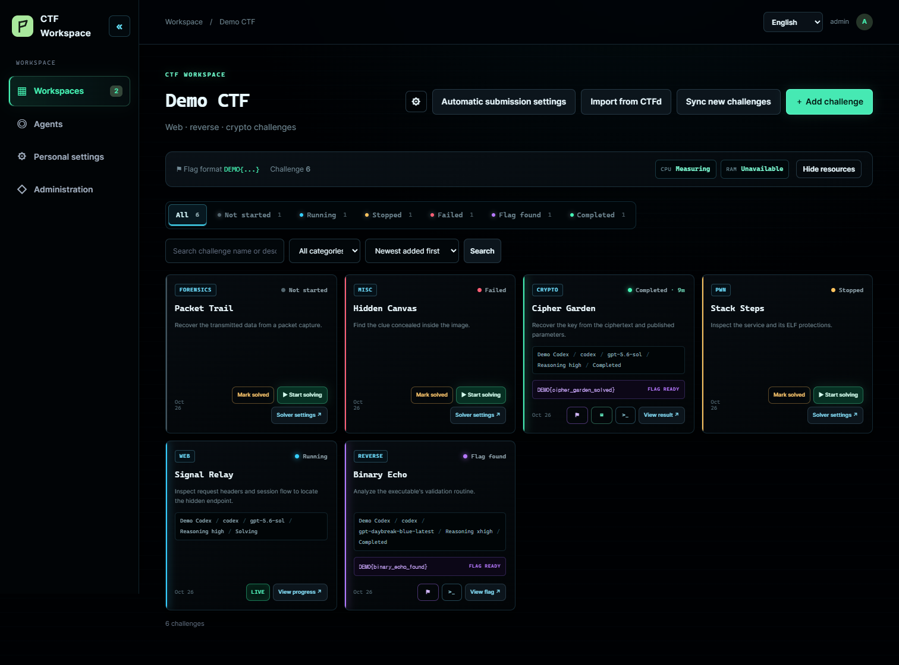
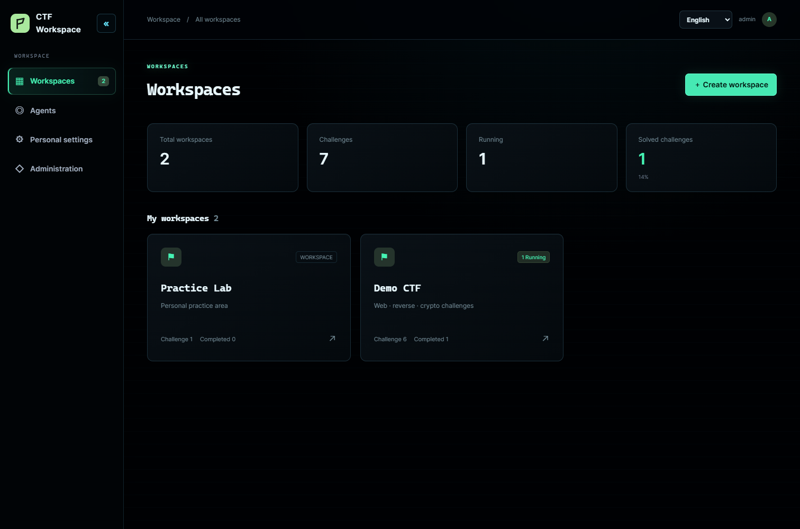
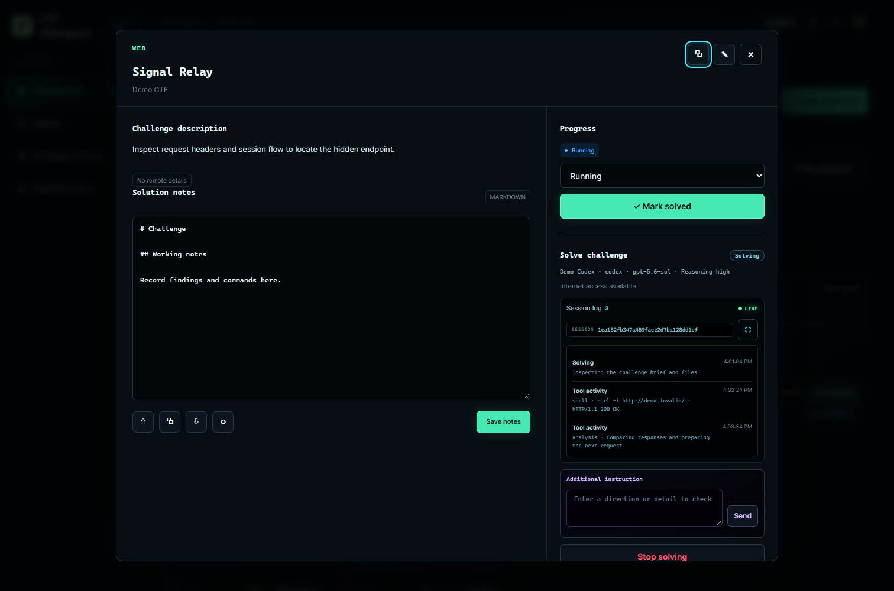
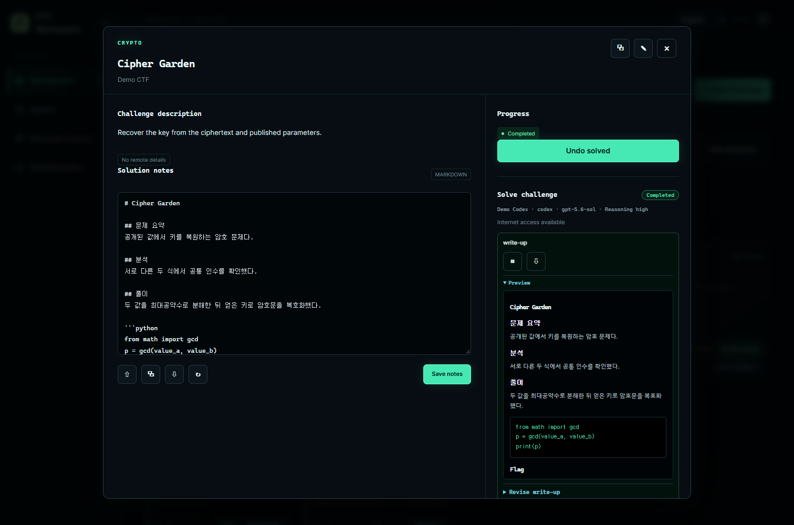
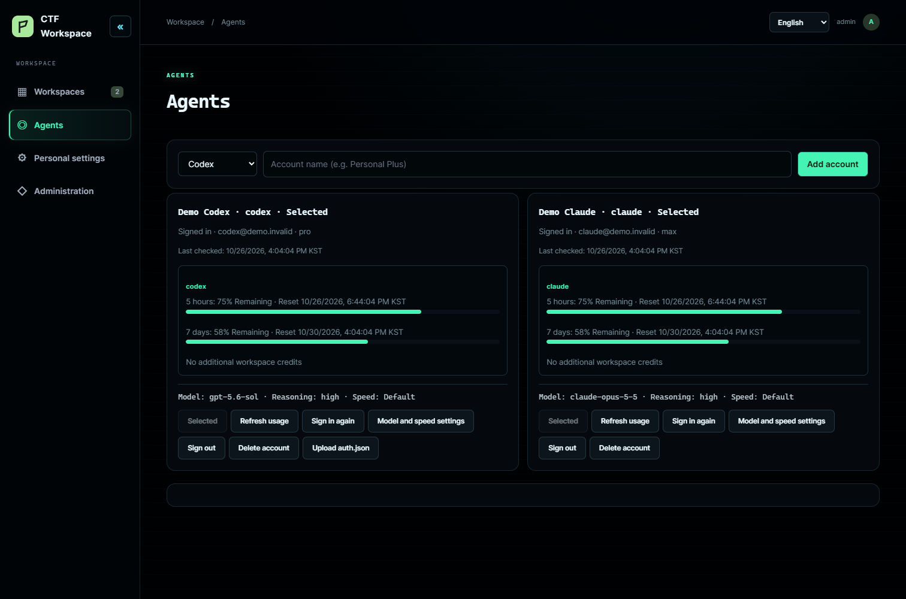
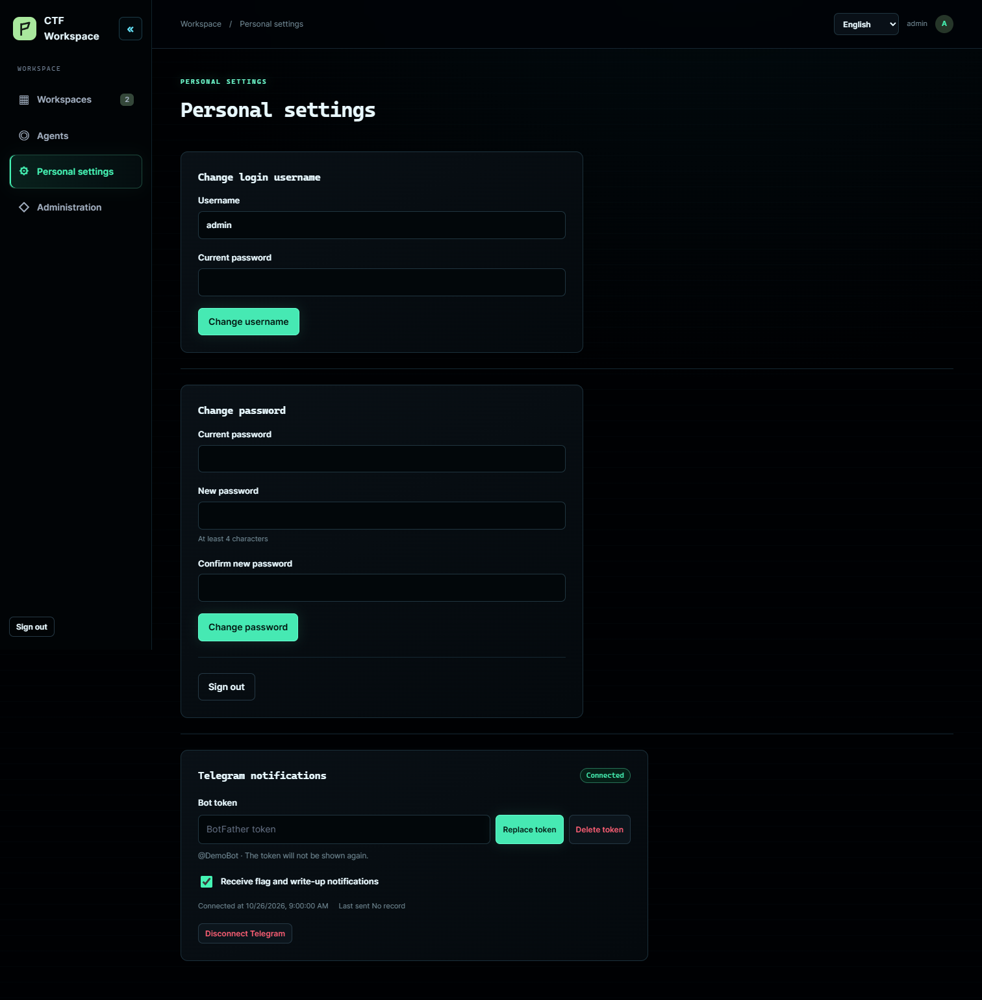
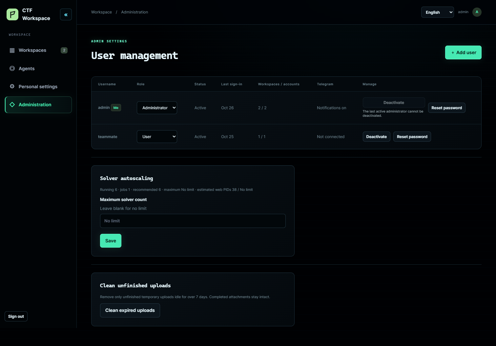

<p align="center"></p>

<h1 align="center">CTF Agent</h1>

<p align="center">A workspace for CTF challenges, solver sessions, files, flags, and write-ups.</p>

<p align="center"><a href="https://github.com/udonsari0101/CTF_Agent/releases/latest">Download</a> · <a href="docs/guides/docker-desktop.md">Windows installation</a> · <a href="docs/README.md">Documentation</a> · <a href="README.ko.md">한국어</a></p>



The screenshots use synthetic challenges and account data.

## Features

- Keep each CTF in a separate workspace. Save a CTFd site and API token or username/password in workspace settings, then reuse that connection for import and optional flag submission; imports can also use new credentials for a single session. Add challenges manually or import selected challenges from CTFd; sync new or changed challenges later. Link related challenges by ID, including challenges with duplicate names.
- Run cloned challenges independently. To coordinate parallel solves, select a sibling run and send a verified observation to one active job. Observations do not cross over automatically.
- Connect Codex and Claude Code through account sign-in or an API key. Choose the account, model, and reasoning level per challenge; see remaining quota when supported by the account connection, live solve time, session activity, and child agents.
- Send instructions during a solve. On retry, a compatible provider session can resume directly. Switching between Codex and Claude Code carries available work files and bounded analysis notes into a new session; if a run stops before it writes notes, a bounded summary of its recorded activity supplies the retry context.
- Upload multiple files, including large binaries with resumable transfers. Stage files in a workspace before challenge details are available, then attach them to one or more challenges. Challenge files and the database use separate data directories.
- See status and flags update while a solve runs, without refreshing the page. Review, copy, and download Markdown write-ups in the selected interface language; request a revised write-up when needed.
- Each user can register a Telegram bot token in **Personal settings**, connect a chat through a one-time link, and receive flag, write-up, error, and input-request notifications. No bot token is bundled or required during installation. CTFd flag submission is off by default.
- Use the first-run administrator setup for a multi-user installation. A separate no-login mode is available for explicitly configured single-user instances.
- Switch the web interface between English and Korean. Interface translations live in [language packs](docs/guides/localization.md) so more languages can be added.

Move a workspace or challenge between installations with a manual ZIP or an
optional HTTPS direct transfer. The receiving installation shows the exact ZIP
size and estimated unpacked attachment size for approval before transfer.
The bundle carries read-only solver session logs alongside challenge data;
credentials and resumable provider sessions stay on the source installation.
Files still staged at the workspace level are not in the transfer bundle; attach
them to challenges before moving the workspace.
The [transfer guide](docs/guides/workspace-transfer.md) explains the public
HTTPS requirement, retries, and the manual ZIP route for local-only or
Cloudflare Access protected destinations.

## Screenshots

| Workspaces | Live solver session |
| --- | --- |
|  |  |
| Write-up preview | Agent accounts |
|  |  |
| Personal settings | Administration |
|  |  |

## Install on Windows

1. Download the latest `CTF_Agent-*-local-windows.zip` release and extract it to a local folder.
2. Run `Install.cmd`. The installer checks WSL 2, suggests a suitable Linux distribution, checks Docker Desktop and available disk space, then offers the usual data path inside WSL. Press Enter to use it.
3. Open <http://127.0.0.1:5050>. If you selected password login, create the first administrator account; the explicit no-login mode skips that step. Connect a Codex or Claude Code account in **Agents**.

If your existing WSL distribution runs its own Docker Engine, select **N** to create a separate Ubuntu for Docker Desktop. After setting its Linux username and password, type `exit` in the Linux window so the installer can continue.

Open **Administration → Service updates** to check public releases, read release notes, and install an update. `Install.cmd` can also update an existing installation. Both paths preserve the selected data directory. The installer pulls the commit-pinned public GHCR image used on servers, then builds a small verified local runtime layer for the Windows solver policy. It does not rebuild the CTF toolchain. Installation and Start report success after `/readyz` confirms the solver is ready. See the [installation guide](docs/guides/docker-desktop.md) for requirements, troubleshooting, and Windows Explorer access to challenge files.

After a web update that changes the Windows launchers, run the new release's `Install.cmd` once to refresh Start.cmd and Uninstall.cmd in your Windows user profile. The web updater updates the WSL service; it cannot reliably replace Windows launcher files when WSL interop is unavailable. Existing installations with a database VHDX on a Windows drive need the patched release's `Install.cmd` once before web updates can use the verified Docker database path.

The installer asks whether to start CTF Agent when you sign in to Windows. You can always use Start.cmd to start it manually and Uninstall.cmd to remove its containers, local image tags, and installed release files. Both launchers are placed in your Windows user profile under CTF Agent. A shared public image cache may remain. Uninstall keeps the selected data and database folders, WSL distribution, and Docker Desktop.

To open your challenge files from Windows, use Explorer at `\\wsl.localhost\<distribution>\<Linux data path>\ctf_agent_data\workspace_files`.

To place only the database at a Windows location, paste a folder path such as `D:\CTF-Agent\data` at the data path prompt. The installer creates `D:\CTF-Agent\data\ctf-agent-db.vhdx` for the ext4 database; the application and challenge files keep the usual WSL path. Any fixed local drive, including C:, D:, or E:, is accepted even when it also holds the selected WSL distribution. D: is only an example, not a default. Pressing Enter keeps all data at the usual WSL location. The database remains accessible in Explorer through `\\wsl.localhost`; see the [Windows installation guide](docs/guides/docker-desktop.md). Existing databases are not moved automatically.

### Install from source

Run this line inside a WSL 2 distribution with Docker Desktop integration enabled:

```sh
git clone https://github.com/udonsari0101/CTF_Agent.git ~/CTF_Agent && cd ~/CTF_Agent && CTF_AUTH_MODE=password CTF_ALLOW_WEB_BOOTSTRAP=true CTF_LOCAL_UID=$(id -u) CTF_LOCAL_GID=$(id -g) python3 deploy/local-compose.py up -d --build
```

## Solver environment

Each solver runs in a separate container with its own scratch space. The challenge brief, attachments, category playbooks, and analysis notes are assembled for that job. The solver may use the tools relevant to the challenge; a category label is a hint rather than a constraint.

| Field | Available tools and typical uses |
| --- | --- |
| Web | `curl`, Chromium via `ctf-browser`, Playwright interaction via `ctf-browser-act`, `ffuf`, `sqlmap`, `websocat`, Python HTTP libraries: request inspection, paths, sessions, browser forms and uploads. |
| Pwn | `gdb`, `gdbserver`, `pwndbg`, `pwntools`, `ROPgadget`, `ropper`, `seccomp-tools`, `patchelf`, `qemu-user`, `strace`: binary behavior, seccomp filters, and exploit reproduction. |
| Reverse | Ghidra headless, JADX, `GoReSym`, `radare2`, `objdump`, `readelf`, `angr`, LIEF, Capstone, Unicorn, `apktool`, `wabt`: native, Go, Android, and WebAssembly analysis. |
| Crypto | PARI/GP, PyCryptodome, SymPy, `gmpy2`, Z3, `fpylll`, `owiener`, `john`: algebra, lattice, RSA, and password challenges. |
| Forensics | `binwalk`, `foremost`, `exiftool`, Sleuth Kit, `testdisk`, Volatility 3, `tshark`, YARA, `ffmpeg`, `steghide`, `stegseek`: file, disk, memory, traffic, media, and steganography analysis. |
| Network and misc | `dig`, `whois`, `nmap`, Scapy, `socat`, `tesseract`, `zbarimg`, Python: protocol inspection, automation, and OCR. |

[REA](https://github.com/morluto/rea) is not bundled. It is an optional MCP interface to analysis engines; Ghidra and JADX are already available directly in the image. The supplied solver containers do not mount host GPU or KVM devices. See the [toolchain inventory](docs/guides/ctf-toolchain.md) for versions and execution limits.

## Research references

These projects and studies informed our design review. Their code is not bundled, and their reported solve rates are not performance claims for CTF Agent.

- **Agent coordination and continuity:** [ctf-solver-agent](https://github.com/yakisoba0728/ctf-solver-agent) (solver coordination), [ctfsolver](https://github.com/hongyime/ctfsolver) (file-based handoff), [Muteki](https://github.com/FishCodeTech/muteki) (evidence-linked findings), and [Veria Labs ctf-agent](https://github.com/verialabs/ctf-agent) (parallel workers and submission cooldown). We reviewed these ideas without importing their implementations.
- **Tool use and failure analysis:** [EnIGMA](https://proceedings.mlr.press/v267/abramovich25a.html) (interactive tools and observed output), [PwnAgent](https://link.springer.com/article/10.1186/s42400-026-00649-5) (debugger feedback), [Reveree](https://arxiv.org/html/2609.01185) (reverse-engineering milestones), and [A Second Look](https://arxiv.org/html/2605.21497) (orchestration's time and cost trade-offs).
- **Evaluation design:** [Baselines Before Architecture](https://arxiv.org/html/2607.13085) ([artifact](https://github.com/krodalabs/coding-agent-research-artifact)) motivates a same-model, same-budget plain-CLI control; its historical XBOW web results are not general CTF scores. [CTFusion](https://github.com/kaist-hacking/CTFusion) studies isolated live-CTF comparisons, while [CTF-ABACUS](https://arxiv.org/html/2608.26237) audits flag provenance.
- **Public test material:** [NYU CTF Bench](https://github.com/NYU-LLM-CTF/NYU_CTF_Bench) provides public development/test splits, [Cybench](https://github.com/andyzorigin/cybench) includes subtasks, and [CTFTiny](https://github.com/NYU-LLM-CTF/CTFTiny) supports smaller-scale checks. [CTF-Dojo](https://proceedings.mlr.press/v306/zhuo26c.html) contributes executable training tasks; its published improvement is from model training, not a runtime harness. Public answers may have been encountered during training or search. Any future live results should be reported separately.

## Source-to-implementation map

The table distinguishes bundled tools and protocol integrations from design references. CTF Agent's orchestration and evaluation code is independently implemented; the cited projects' agent code is not copied. The evaluation tooling below does not yet represent a completed model benchmark.

| Source | What was reflected | Where to find it |
| --- | --- | --- |
| [CTFd](https://github.com/CTFd/CTFd) | Challenge and attachment import, later synchronization, and optional Flag submission through CTFd-compatible endpoints. | [CTFd client](ctf_agent/ctfd.py) and [submission worker](ctf_agent/ctfd_submit.py). Direct protocol integration; auto-submit defaults to off. |
| [Ghidra](https://github.com/NationalSecurityAgency/ghidra) and [JADX](https://github.com/skylot/jadx) | Headless native and Android/DEX decompilation commands in the solver image. | [Toolchain image](Dockerfile.toolchain) and [image smoke checks](deploy/image-smoke.py). Upstream tools are installed; their agent logic is not used. |
| [Pwndbg](https://github.com/pwndbg/pwndbg) | GDB-assisted binary inspection for pwn tasks. | [Toolchain image](Dockerfile.toolchain) and [image smoke checks](deploy/image-smoke.py). Upstream tool installation. |
| [ctfsolver](https://github.com/hongyime/ctfsolver) | CTFd challenges handed to isolated, tool-equipped agent containers were compared with our solve workflow. | [CTFd client](ctf_agent/ctfd.py) and [solver worker](ctf_agent/solver_worker.py). Independent workflow design; no upstream agent code was imported. |
| [CTFusion](https://github.com/kaist-hacking/CTFusion) | Independent attempts and separation of local Flag findings from official CTFd submission informed the evaluation boundary. | [Benchmark protocol](docs/benchmarking/protocol.md) and [submission worker](ctf_agent/ctfd_submit.py). Design reference; no live benchmark result is claimed. |
| [Baselines Before Architecture](https://arxiv.org/html/2607.13085) ([artifact](https://github.com/krodalabs/coding-agent-research-artifact)) | Motivates a same-model, same-budget plain-CLI control distinct from our existing minimal-prompt app-server control. | [Benchmark protocol](docs/benchmarking/protocol.md), [plan validator](scripts/benchmark_plan.py), and [report validator](scripts/benchmark_report.py). Plain-CLI trials remain blocked until provider credentials can be isolated from model tools. |
| [NYU CTF Bench](https://github.com/NYU-LLM-CTF/NYU_CTF_Bench) and [Cybench](https://github.com/andyzorigin/cybench) | Reproducible challenge inputs, a separate answer oracle, and category-aware reporting guide the benchmark manifest. | [Benchmark protocol](docs/benchmarking/protocol.md) and [preflight audit](docs/benchmarking/preflight-audit.md). Their problem sets are not bundled in this repository. |
